# TigerWage

A full-stack job search tracker. Browse job listings, track every application from "applied" to "offer," attach documents, manage a library of tailored résumés, and get email reminders for upcoming interviews and follow-ups.

Built with **Angular**, **Node.js / Express**, **MySQL**, and **AWS** (S3 and SES).

> **Live demo:** _coming soon_

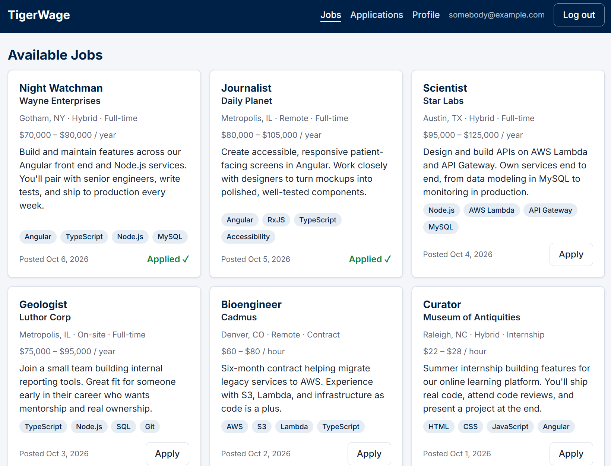
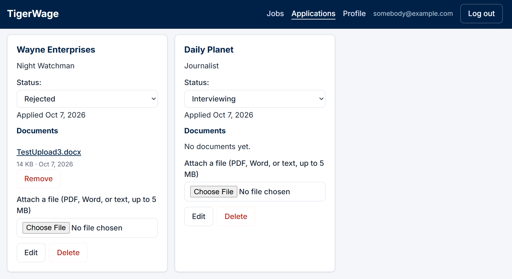
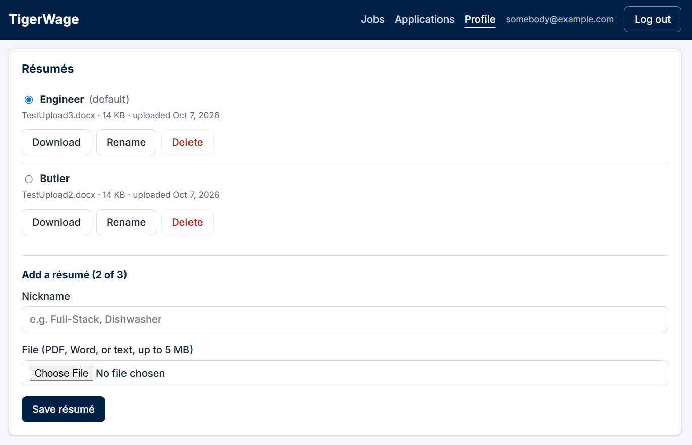
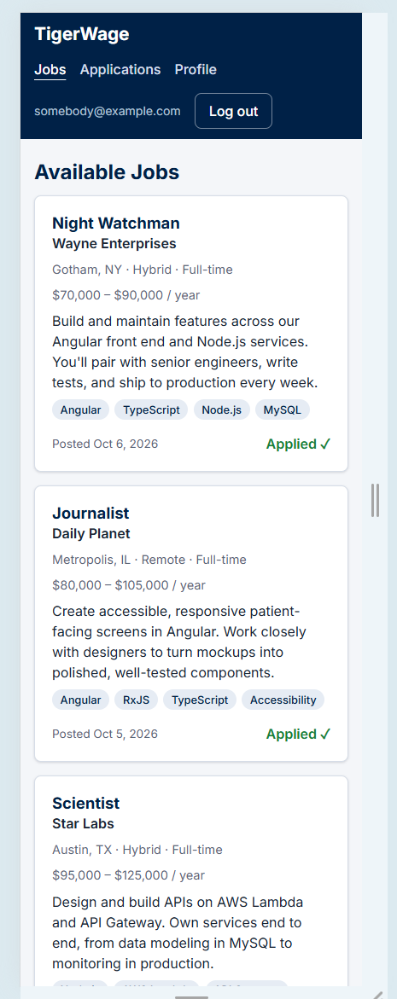

<details>
  <summary>More screenshots</summary>
  <p>
    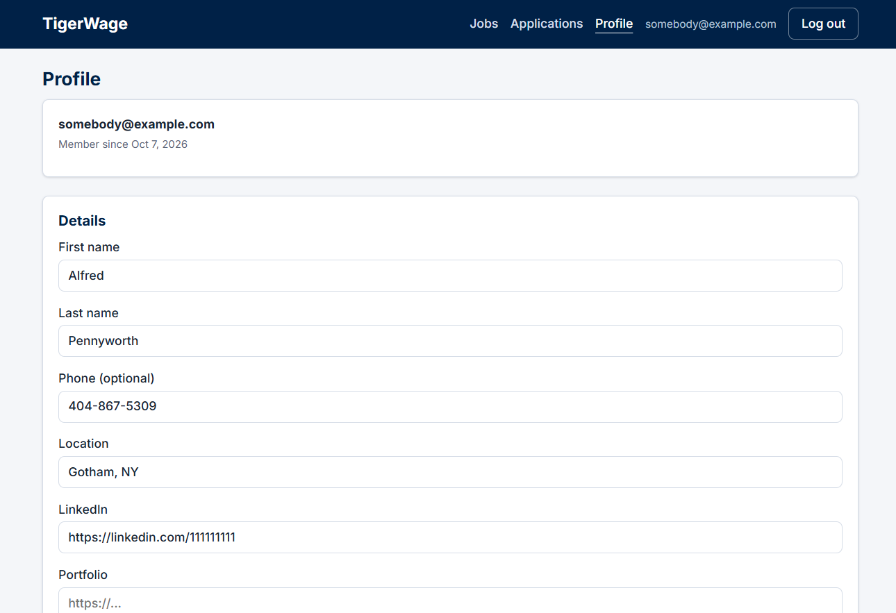
    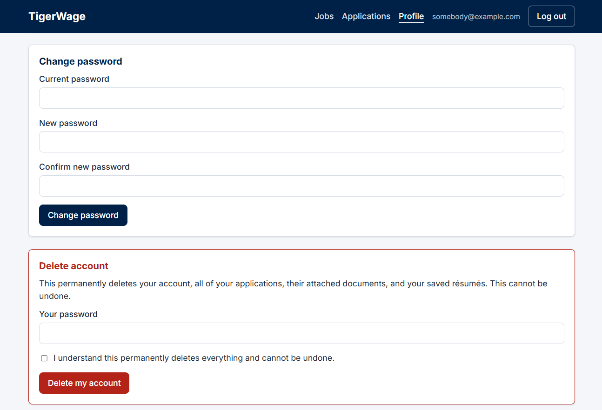
    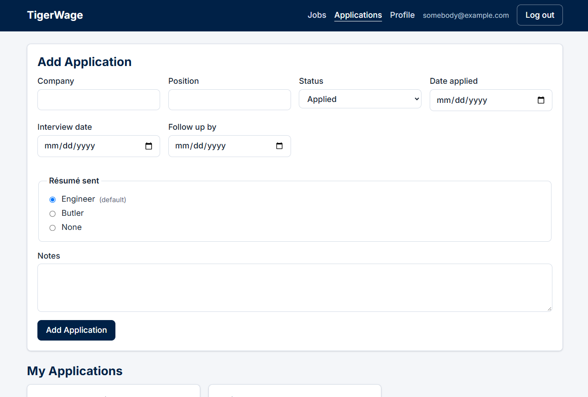
    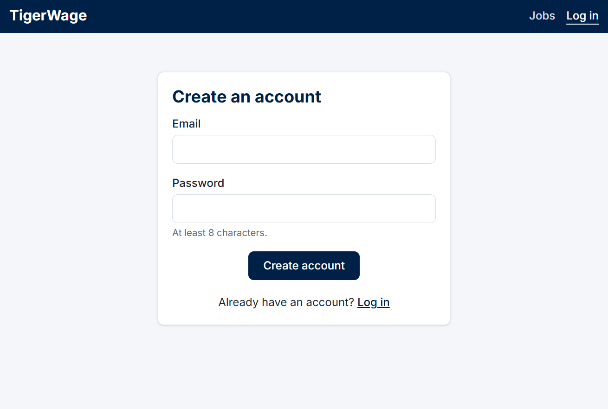
    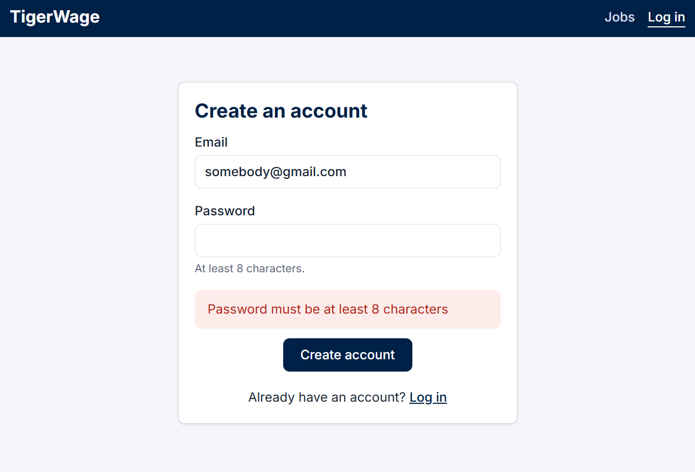
    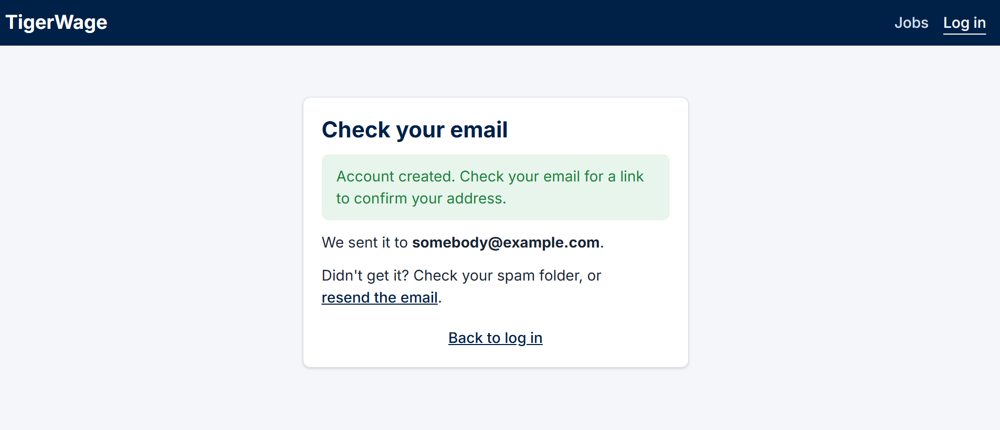
    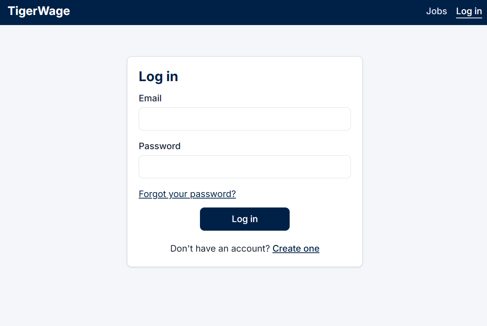
    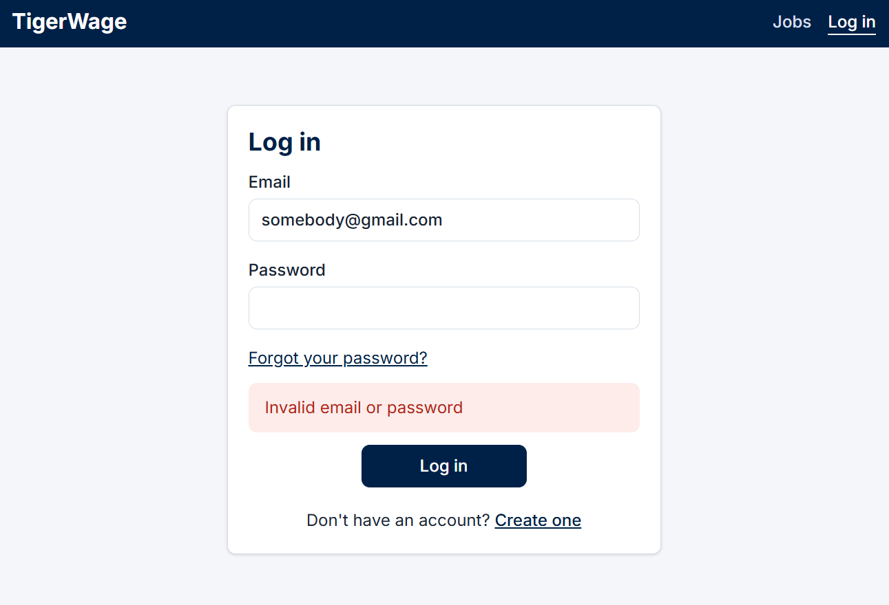
  </p>
</details>

---

## Features

**Job board**
- Public job listings displayed as responsive cards (no account needed to browse)
- One-click apply that records the application with today's date and your default résumé
- Cards stay in sync with your applications: delete an application and its Apply button returns

**Application tracking**
- Create, edit, and delete applications with status, dates, and notes
- Change status inline from the list
- Attach documents (PDF, Word, or text, up to 5 MB) stored privately in Amazon S3
- Choose which saved résumé you sent with each application

**Résumé library**
- Save up to 3 résumés, each with a nickname (for example "Frontend" or "Contract roles")
- Pick a default with a radio button; it's preselected for new applications
- Rename, download, and delete

**Reminders**
- Optional interview and follow-up dates on each application
- A daily job sends one digest email per user listing everything due

**Accounts**
- Sign up with email confirmation
- Log in, log out, and stay logged in across page refreshes
- Forgot-password flow with one-time emailed links
- Profile page: edit personal details, change password, delete account (removes all data and files)

---

## Tech stack

| Layer | Technology |
|---|---|
| Front end | Angular (standalone components, zoneless change detection, signals), RxJS, Reactive Forms, TypeScript |
| Back end | Node.js, Express 5, TypeScript |
| Database | MySQL 8 (`mysql2`) |
| File storage | Amazon S3 with presigned upload and download URLs |
| Email | Amazon SES (with a console mode for local development) |
| Auth | bcrypt, JSON Web Tokens, rotating refresh tokens in `httpOnly` cookies |
| Scheduling | `node-cron` locally (EventBridge Scheduler planned for production) |

---

## Architecture

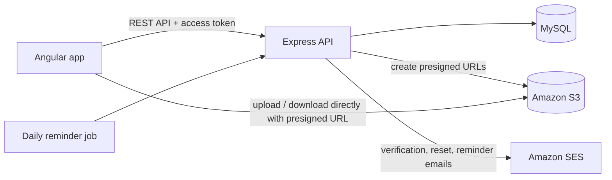

Files never pass through the API server. The browser asks the API for a short-lived presigned URL, uploads straight to S3, then the API verifies the file's real size and type before saving a record. This keeps the server lightweight and fits within AWS Lambda's request size limits.

---

## Security highlights

- **Passwords** hashed with bcrypt (cost factor 12); never stored or logged in plain text
- **Short-lived access tokens** (15 minutes) kept in memory, not `localStorage`, to limit exposure to XSS
- **Rotating refresh tokens** in `httpOnly`, `SameSite=Strict` cookies, stored only as SHA-256 hashes; reuse of an old token fails
- **Email links** (confirmation, password reset) are random one-time tokens, stored hashed, with expirations
- **Rate limiting** on login, registration, and email-sending routes, plus a honeypot field to catch simple bots
- **Parameterized SQL** everywhere to prevent SQL injection
- **Ownership checks** on every query to prevent insecure direct object references (IDOR)
- **Allow-listed fields** on updates to prevent mass assignment
- **Private S3 bucket** with server-generated file keys, post-upload verification, and a least-privilege IAM policy
- **HTML escaping** of user content in emails, and **open-redirect protection** on post-login redirects
- **Generic error messages** that don't reveal whether an email address has an account

---

## Project structure

```
tigerwage/
├── client/            Angular front end
│   └── src/app/
│       ├── components/   Reusable UI (job board, forms, lists, résumé library)
│       ├── pages/        Routed pages (jobs, applications, profile, login, ...)
│       └── services/     API access and shared state
├── server/            Express API
│   └── src/
│       ├── auth/         Token helpers
│       ├── email/        Email sender and templates
│       ├── jobs/         Scheduled reminder job
│       ├── middleware/   Authentication and rate limiting
│       ├── routes/       API routes
│       └── storage/      S3 helpers and file rules
└── database/          SQL schema and seed data
```

---

## Getting started

### Prerequisites

- Node.js 20.19 or later, and the Angular CLI (`npm install -g @angular/cli`)
- MySQL 8
- An AWS account with an S3 bucket (for file uploads) and, optionally, SES (for real emails)
- The AWS CLI (for saving AWS credentials)

### 1. Clone the repository

```bash
git clone https://github.com/KevinBMilo/tigerwage.git
cd tigerwage
```

### 2. Set up the database

In the MySQL command line as an administrator (start it from the repository folder, or use the full path to each file):

```sql
SOURCE database/schema.sql
SOURCE database/seed-jobs.sql
```

Then create a limited user for the app:

```sql
CREATE USER 'tigerwage_app'@'localhost' IDENTIFIED BY 'choose-a-strong-password';
GRANT SELECT, INSERT, UPDATE, DELETE ON tigerwage.* TO 'tigerwage_app'@'localhost';
FLUSH PRIVILEGES;
```

### 3. Configure AWS (for file uploads)

1. Create a private S3 bucket (block all public access) with this CORS configuration:

   ```json
   [
     {
       "AllowedOrigins": ["http://localhost:4200"],
       "AllowedMethods": ["PUT", "GET"],
       "AllowedHeaders": ["*"],
       "ExposeHeaders": ["ETag"],
       "MaxAgeSeconds": 3000
     }
   ]
   ```

2. Create an IAM user with only these permissions: `s3:PutObject`, `s3:GetObject`, `s3:DeleteObject` (on `bucket/*`), `s3:ListBucket` (on the bucket), and `ses:SendEmail`.
3. Save its credentials locally with `aws configure --profile tigerwage`.

### 4. Configure and start the API

```bash
cd server
npm install
cp .env.example .env
```

Fill in `.env` (see the table below). Generate a signing secret with:

```bash
node -e "console.log(require('crypto').randomBytes(64).toString('hex'))"
```

Then start the API at http://localhost:3000:

```bash
npm run dev
```

### 5. Start the front end

In a second terminal:

```bash
cd client
npm install
ng serve
```

Open http://localhost:4200.

With `EMAIL_MODE=console`, emails (including confirmation links) are printed in the API's terminal instead of being sent.

### Environment variables

| Variable | Description |
|---|---|
| `DB_HOST`, `DB_USER`, `DB_PASSWORD`, `DB_NAME` | MySQL connection |
| `JWT_ACCESS_SECRET` | Long random string used to sign access tokens |
| `CORS_ORIGIN` | Front-end address allowed to call the API (`http://localhost:4200`) |
| `APP_URL` | Front-end address used in email links |
| `EMAIL_MODE` | `console` to print emails, `ses` to send them |
| `EMAIL_FROM` | Sender address (must be verified in SES) |
| `AWS_REGION` | AWS region, for example `us-east-1` |
| `AWS_PROFILE` | AWS CLI profile name holding the credentials |
| `S3_BUCKET` | Bucket for documents and résumés |
| `REMINDERS_CRON` | When the reminder job runs, for example `"0 8 * * *"`; leave unset to disable |

### Useful scripts

| Command (in `server`) | Description |
|---|---|
| `npm run dev` | Start the API with auto-restart |
| `npm run reminders` | Run the reminder job once |

---

## API overview

| Area | Endpoints |
|---|---|
| Auth | `POST /api/auth/register`, `login`, `refresh`, `logout`, `verify-email`, `resend-verification`, `forgot-password`, `check-reset-token`, `reset-password`, `change-password`, `verify-password`, `delete-account`; `GET /api/auth/me` |
| Jobs | `GET /api/jobs` (public), `POST /api/jobs/:id/apply` |
| Applications | `GET`, `POST /api/applications`; `PATCH`, `DELETE /api/applications/:id` |
| Documents | `GET`, `POST /api/applications/:id/documents`; `POST .../upload-url`; `GET .../:documentId/download-url`; `DELETE .../:documentId` |
| Résumés | `GET`, `POST /api/resumes`; `POST /api/resumes/upload-url`; `PATCH`, `DELETE /api/resumes/:id`; `GET /api/resumes/:id/download-url` |
| Profile | `GET`, `PATCH /api/profile` |

All other routes require an access token, except registration, login, the public job list, email-link routes, and token refresh and logout (which use the refresh cookie).

---

## Design decisions

- **Presigned URLs instead of proxying uploads** keep files off the API server and respect Lambda's payload limits.
- **Transactions with row locks** (`SELECT ... FOR UPDATE`) enforce the 3-résumé limit and single default even when two requests arrive at once.
- **Database constraints do the hard work:** a unique key prevents applying to the same job twice, and `ON DELETE CASCADE` cleans up related records when an account is deleted.
- **One source of truth on the front end:** services hold shared state in RxJS `BehaviorSubject`s, and components derive what they show (such as "Applied ✓" badges) with Angular signals, so different parts of the page can't disagree.
- **Dates, not times, for reminders** avoid time-zone bugs between the server, database, and users.

---

## Roadmap

- [ ] Deploy to AWS: Angular on S3 + CloudFront, API on Lambda + API Gateway, MySQL on RDS, reminders on EventBridge Scheduler
- [ ] Visual design and styling
- [ ] Job search and filters
- [ ] Change email address
- [ ] Reminder preferences with unsubscribe links
- [ ] Cleanup jobs for abandoned uploads and expired tokens
- [ ] Automated tests

---

## Author

**Kevin Swiney**
[LinkedIn](https://www.linkedin.com/in/kevin-s-aa7898163) · [GitHub](https://github.com/KevinBMilo)
